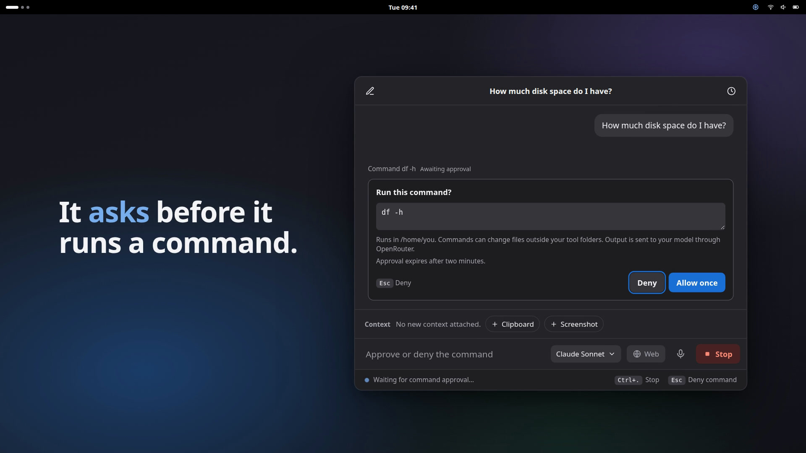

# Ntikuma

[](https://github.com/divinecodes/ntikuma/actions/workflows/ci.yml)
[](https://github.com/divinecodes/ntikuma/releases/latest)
[](LICENSE)
[](go.mod)
[](https://divinecodes.github.io/ntikuma/)

**[Website](https://divinecodes.github.io/ntikuma/)** · **[Download the latest .deb](https://github.com/divinecodes/ntikuma/releases/latest)** · [Installation](INSTALLATION.md) · [Privacy](PRIVACY.md)



A GNOME popup assistant for quick questions. Open it with Super+Space, type or dictate a question, and dismiss it when you are done. Answers stream from OpenRouter, or directly from OpenAI, Anthropic, Ollama or another OpenAI-compatible API you add in Preferences. Conversations stay in a local SQLite database, and voice transcription supports local Qwen3-ASR, Parakeet, Cohere Transcribe, or a separately installed whisper.cpp server.

Built with Go, Wails v3.0.0-beta.34, and Svelte 5.

For a complete setup, see [Installation and local voice models](INSTALLATION.md). It covers app dependencies, model downloads, Voice Preferences, installed runtimes, and troubleshooting.

See [Privacy](PRIVACY.md) for what is processed locally and what goes to OpenRouter or a direct provider. Use the private reporting route in the [security policy](SECURITY.md) for vulnerabilities.

## Requirements

- Linux with a GNOME desktop session.
- Go 1.26 or newer, as required by `go.mod`.
- Node.js 24.15 or newer on the Node 24 line, and npm for frontend development and tests.
- An OpenRouter API key for answering questions, or a direct provider (see [Providers](#providers)); a server on this computer, such as Ollama, needs no key.
- For screenshots, an XDG desktop screenshot portal with interactive capture support. GNOME uses `xdg-desktop-portal` and `xdg-desktop-portal-gnome`.
- For dictation, a microphone, `pw-record` or `parecord`, and a configured transcription runtime with a downloaded model.

On Ubuntu, install the build dependencies:

```bash
sudo apt update
sudo apt install build-essential pkg-config libgtk-4-dev libwebkitgtk-6.0-dev \
  git cmake curl pipewire-bin python3 desktop-file-utils
```

The default build uses GTK4 and WebKitGTK 6.0. See the [Wails Linux setup documentation](https://v3.wails.io/contributing/setup). Install Go and Node.js separately if they are not available at the versions above.

## Development setup

Run these commands from the Ntikuma repository root:

```bash
./scripts/bootstrap.sh
wails3 dev
```

Bootstrap installs the Wails CLI version pinned in `go.mod` when needed, generates missing local build tooling, downloads Go modules, runs `npm ci`, and checks native dependencies with `wails3 doctor`. The entire `build/` directory is ignored by Git. Bootstrap creates a temporary Wails project, applies Ntikuma's metadata and Linux packaging, and copies only missing build files into the checkout. Existing local build files and application source are preserved.

After pulling dependency updates, check that Node meets the requirement above and rerun bootstrap before `wails3 dev`. This updates an older Wails CLI to match the project. Go also excludes `build/` from its package scans so the native speech helper's downloaded modules are not treated as application source.

If you prefer to install the pinned CLI yourself, run it before bootstrap:

```bash
go install github.com/wailsapp/wails/v3/cmd/wails3@v3.0.0-beta.34
export PATH="$(go env GOPATH)/bin:$PATH"

./scripts/bootstrap.sh
wails3 dev
```

The application starts in the tray with its popup hidden. Click its tray icon, or run this from the repository root in another terminal once the development build finishes:

```bash
./bin/ntikuma show
```

Open Preferences with Ctrl+, and save your OpenRouter key, or add a direct provider (see [Providers](#providers)). It is stored in GNOME Keyring, separately from the preferences file. Preferences save automatically; wait for Saved after changing a setting.

For development, setting `NTIKUMA_OPENROUTER_KEY` before launch overrides the saved OpenRouter key.

To keep the popup open while inspecting it:

```bash
NTIKUMA_KEEP_OPEN=1 NTIKUMA_DEVTOOLS=1 wails3 dev
```

## Selected-text context

Enable Attach selected text when Ntikuma opens in Preferences. Select a passage in another application, then open a fresh Ntikuma question. When the source application shares its primary selection, a Selection chip appears. This is separate from copying text with Ctrl+C. The clipboard auto-attach switch controls copied text; selected text has its own preference.

On X11, Ntikuma snapshots the selection before raising the popup. On Wayland, it reads the primary selection after receiving focus, as required by the compositor's selection protocol. The source application must keep its selection available when focus changes. Your session's capture behavior is shown in Preferences. [Wayland primary selection](https://wayland.app/protocols/primary-selection-unstable-v1), [GTK primary clipboard](https://docs.gtk.org/gdk4/method.Display.get_primary_clipboard.html).

Remove a Selection chip with × to exclude it. Dismissal stays in effect when reopening the question bar; Selected text retries capture, and Ctrl+N starts a new question with automatic capture enabled again. In an existing chat, use Selected text to add context to a follow-up. Disabling the selection preference drops its unsent chip and ignores any pending capture result. Sent selections remain with their chat and are included in follow-ups.

An empty, unavailable, or failed selection shows a context message and leaves the composer usable. Ntikuma never substitutes copied clipboard text for a missing selection and ignores selections owned by its GTK application. Some applications do not publish highlighted text or clear it when losing focus. Copy the passage and attach Clipboard in that case.

Selected-text capture uses the Linux GTK4 build, with X11 or a Wayland compositor that advertises native primary-selection support. Unsupported builds or sessions display an unavailable state. No `wl-paste` or `xclip` helper is needed. Transfers time out after 500 ms and reject selections larger than 4 MiB. The Text context limit bounds bytes per selection or clipboard attachment sent to the model; zero disables that outgoing limit but leaves the selection transfer bound in place.

## Screenshot context

Enable Offer a screenshot in Preferences, then click Screenshot in the question bar or chat composer. Ntikuma hides while the desktop capture dialog is open. Choose a screen, window, or area from the choices your desktop offers. Ntikuma restores the draft afterward and adds a removable screenshot chip. Canceling returns to the draft without attaching an image. Some GNOME portal versions report cancellation as a generic capture failure; the draft remains available to retry.

Remove the chip with × before sending to exclude the new screenshot. A sent screenshot stays in the local chat database and is included in follow-up questions, including after reopening the chat from History. A capture longer than 2,048 pixels on either side is scaled down to fit, in its original PNG or JPEG format, since providers scale larger images down before the model sees them; the chip label shows the size that is sent and saved. Follow-ups resend only the four most recent screenshots in a chat, up to 24 MiB in total; older ones are replaced with a note to the model. Once a conversation passes its budget, its oldest turns are no longer sent, and the model is told that earlier messages were left out. The budget is about half the smallest context window among the chosen model and its fallbacks, at roughly four characters a token, and at most 300,000 characters. Ntikuma reads the windows from OpenRouter's model catalog (cached for 10 minutes) only once a chat passes 16,000 characters; if the catalog can't be read, it uses 300,000. History shows its label. Delete the chat or clear history to remove its stored screenshots.

Screenshots need an image-capable model. On OpenRouter, for a chat containing images, Ntikuma checks the current model catalog and skips configured models that do not advertise image input. It preserves the order of compatible defaults/fallbacks and reports a fallback when one answers. If no configured model supports images, choose one in Preferences or the model picker. A catalog lookup failure asks you to retry. Images are never silently discarded to use a text-only model. [OpenRouter image inputs](https://openrouter.ai/docs/guides/overview/multimodal/image-understanding), [model capabilities](https://openrouter.ai/docs/api/api-reference/models/list-all-models-and-their-properties).

Each screenshot must be PNG or JPEG, at most 10 MiB and 40 megapixels. Capture a smaller area if it exceeds either limit. The text context limit does not truncate images. Temporary portal files are removed after reading, including when an image is rejected. Pictures saved by GNOME outside the temporary directory remain in their original location; removing a chip or deleting a chat does not delete those desktop-owned pictures.

The capture dialog requires screenshot portal version 2 or newer. Its available targets depend on the desktop backend. Ntikuma requests interactive capture and does not assume the previously active window. [Screenshot portal](https://flatpak.github.io/xdg-desktop-portal/docs/doc-org.freedesktop.portal.Screenshot.html).

## Build and run

From the repository root:

```bash
wails3 build
./bin/ntikuma start
```

The binary is written to `bin/ntikuma`. The `start` command runs in the tray until you quit. Use a second terminal to control the running instance:

| Command | Action |
| --- | --- |
| `./bin/ntikuma toggle` | Show or hide the popup |
| `./bin/ntikuma show` | Show the popup |
| `./bin/ntikuma voice` | Open dictation |
| `./bin/ntikuma history` | Open history |
| `./bin/ntikuma settings` | Open preferences |
| `./bin/ntikuma quit` | Quit the running instance |
| `./bin/ntikuma version` | Print the version |

## Debian package

Build a complete Linux amd64 package with the native speech helper and libraries:

```bash
python3 scripts/package-deb.py --version 0.1.0
```

The package and `SHA256SUMS` are written under `bin/packages/0.1.0/`. See [Debian installation and packaging](INSTALLATION.md#debian-package) for build dependencies, installation, user setup, and existing-install considerations. Models remain separate downloads. The application is [MIT licensed](LICENSE); the package includes dependency notices and bundled-library licenses.

Moving from `scripts/install.sh`? Follow the [source-install migration](INSTALLATION.md#move-a-source-installation-to-the-debian-package). `ntikuma-migrate-deb` previews the transition; `--apply` creates private backups and updates existing launchers, shortcuts, and known speech-helper paths while keeping your chats and models.

Merged PRs prepare draft GitHub releases, starting at `0.1.0` and incrementing patches by default. `release:minor`, `release:major`, and `release:skip` override that behavior. See the [release process](https://github.com/divinecodes/ntikuma/blob/master/RELEASING.md) for review, recovery, and initial setup. Publishing a draft remains a maintainer action.

## Install for daily use

Build first, then run the installer from the repository root:

```bash
wails3 build
./scripts/install.sh
```

This installs the binary to `~/.local/bin/ntikuma`, adds the Ntikuma launcher and icon, enables login autostart in the tray, offers to configure GNOME shortcuts, and starts the app. No `sudo` is needed. The launcher opens the popup; login autostart keeps it hidden.

Running the installer again upgrades the binary and desktop entries. It asks the running instance to quit first and preserves preferences, chat history, and keyring credentials.

Installer options:

| Option | Effect |
| --- | --- |
| `--no-start` | Install without starting the new binary; the previous instance is still asked to quit |
| `--no-shortcuts` | Skip shortcut changes; existing bindings remain |
| `--no-autostart` | Do not enable autostart; remove this installer's existing autostart entry |
| Final positional argument | Use another built binary instead of `bin/ntikuma` |

For example, install without launching the app or touching shortcuts:

```bash
./scripts/install.sh --no-start --no-shortcuts
```

The installer respects `XDG_DATA_HOME`, `XDG_CONFIG_HOME`, and `XDG_CACHE_HOME`. `NTIKUMA_BIN_DIR` overrides the default `~/.local/bin`; custom installation directories must be absolute. Launchers use the application ID `dev.divinetettey.ntikuma`. Startup failures are recorded in `~/.cache/ntikuma/startup.log`, under `XDG_CACHE_HOME` when set.

## GNOME shortcuts

After building, run this from the repository root:

```bash
NTIKUMA_BIN="$PWD/bin/ntikuma" ./scripts/install-shortcuts.sh
```

This binds Super+Space to show/hide and Super+Shift+Space to dictation. GNOME may already use these keys to switch keyboard layouts. The script asks before reassigning them and prints commands for restoring the layout shortcuts. If you decline, choose alternative keys in GNOME Settings under Keyboard and Custom Shortcuts.

To remove Ntikuma's bindings:

```bash
./scripts/install-shortcuts.sh --remove
```

Removal does not reset keyboard-layout shortcuts. Preferences also offers an experimental GlobalShortcuts portal option, which takes effect after restarting Ntikuma.

## Voice setup

Follow [INSTALLATION.md](INSTALLATION.md) for the complete setup, including `uv` and Python, the native speech helper, downloads, and configuring each model:

| Transcription model | Setup | Runtime |
| --- | --- | --- |
| Parakeet TDT 0.6B v3 | [Download and configure](INSTALLATION.md#parakeet) | Native helper, CPU, automatic language detection |
| Qwen3-ASR 0.6B | [Download and configure](INSTALLATION.md#qwen3-asr) | Native helper, CPU, automatic language detection |
| Cohere Transcribe 2B | [Download and configure](INSTALLATION.md#cohere-transcribe) | Native helper, CPU, explicit language; defaults to English |
| Whisper | [Build and configure whisper.cpp](INSTALLATION.md#whisper-through-whispercpp) | Separate local `whisper-server` |

Choose the model in Preferences > Voice, check its setup, and wait for Saved. Each native model remembers its own folder and CPU thread count; Cohere also saves its language. Preference changes apply to the next recording. All options need `pw-record` or `parecord` for microphone capture.

The Debian package includes the native helper and its libraries. For source installations, build them separately; `scripts/install.sh` copies the main app only, so follow [installed runtime setup](INSTALLATION.md#install-for-daily-use). Models are downloaded through the setup scripts, not from Preferences.

### Download Cohere Transcribe

The [Cohere installation steps](INSTALLATION.md#cohere-transcribe) cover the verified int8 bundle, required external encoder weights, Silero speech detector, and language setting. Complete the [shared native setup](INSTALLATION.md#set-up-native-transcription) first.

### Use dictation

1. Click a microphone button, choose Dictate from the tray, or press Super+Shift+Space after installing the shortcuts.
2. Speak while the Listening timer runs.
3. Press Enter to stop, transcribe, and send immediately. Press Tab to stop and edit the transcript first.
4. In review, edit the text and press Enter or click Send. Shift+Enter inserts a newline. Record again discards that transcript and starts a fresh recording.
5. Esc returns to the previous view. Dismissing the voice view cancels its recording or transcription.

The active provider's key (when it needs one) is needed to send the question, but not to transcribe locally. Stop an existing answer before submitting another transcript.

The input display shows measured microphone activity from the same 16 kHz mono WAV used for transcription. Levels update ten times per second, using recent signed 16-bit PCM samples and a logarithmic display scale. Digital silence leaves the bars flat; speaking raises them. The display waits for the recorder to write its first samples and can lag briefly while the recorder buffers audio. Metering opens no second microphone stream and does not modify the WAV. [PipeWire recording formats](https://pipewire.pages.freedesktop.org/pipewire/page_man_pw-cat_1.html).

With reduced motion enabled, the history bars become a simple current-level indicator. Stopping, canceling, closing dictation, and quitting stop level collection and remove its listener. Each recording has its own event ID so delayed levels cannot appear in the next recording.

## Keyboard controls

| Key | Action |
| --- | --- |
| Enter | Send typed input; with an empty command bar, open the highlighted recent chat |
| Up/Down | Select a recent chat or history result |
| Esc | Hide the command bar/chat; return from history, preferences, or voice |
| Ctrl+. | Stop the answer and retain its partial text |
| Ctrl+N | Start a new chat |
| Ctrl+H | Open history |
| Ctrl+G | Toggle Web search in the question bar or chat |
| Ctrl+, | Open preferences |
| Delete in history | Delete the selected chat when the search input is empty |

Hiding a text chat does not stop its answer. Reopening resumes a streaming chat or a recently used chat. Links in answers and history previews open in your external browser.

## Providers

Questions go to OpenRouter by default. To send them straight to a provider instead, open Preferences, pick a preset under **Provider** and select **Add provider**; the new provider becomes active. Switch between providers with **Send questions to**. One provider is active at a time, and a switch takes effect from the next question.

| Preset | Address | Key |
| --- | --- | --- |
| OpenAI | `https://api.openai.com/v1` | Required |
| Anthropic | `https://api.anthropic.com` | Required |
| Ollama | `http://localhost:11434/v1` | Not needed |
| Kimi (Moonshot) | `https://api.moonshot.ai/v1` | Required |
| DeepSeek | `https://api.deepseek.com` | Required |
| Custom | `http://localhost:8080/v1` | Optional on this computer |

While a provider is active, edit its name, address, key and context window under **Provider**, and its default model and up to three fallbacks under **Models**. Remove a provider after switching away from it. Its key is saved in GNOME Keyring for its current address; after you change the address, save the key again. Addresses need `https://`, except for a server on this computer (`localhost`, `127.0.0.0/8`, `::1`). Ntikuma refuses a redirect to a different address rather than send the question and key there.

- **Models:** Preferences suggests models from the provider's own list. Type any model ID if the list can't be loaded. Fallbacks are tried in order, one request each, when a model is missing, rate-limited, timed out or the provider is down, and only before any text has arrived. A wrong key or a bad request isn't retried.
- **Context window:** set it in tokens for a server on this computer; Ntikuma won't select one without it. Ollama's default depends on your GPU memory (4,096 tokens below 24 GiB); `ollama ps` shows the current value and `OLLAMA_CONTEXT_LENGTH` raises it. With a window set, every chat is trimmed to about half of it, and a question that can't fit is refused with a message rather than cut off by the server. Tool results are shortened so each tool step fits in three quarters of the window, leaving room for the answer, with the model's reasoning counted; when not even a useful part fits, the answer stops and says so before running the tool. Remote providers without a window use the 300,000-character budget.
- **Web search** is an OpenRouter feature; the Web pill is off while a direct provider is active.
- **Screenshots** are sent as they are; a model that can't read images returns an error.
- **Anthropic** uses the Messages API (`anthropic-version: 2026-10-21`) with a 32,000-token answer limit, thinking included.
- **OpenAI** uses the Responses API, because its current models can't call tools over Chat Completions while they reason. Each model keeps its default reasoning effort. Requests are sent with `store: false`, so OpenAI doesn't keep the response for later requests; an OpenAI provider added before this change switches over on its own.
- **DeepSeek, Kimi** and similar providers return their reasoning with each answer. While Local tools are on, it's saved with the answer and sent back to the same provider, which DeepSeek requires. See [Privacy](PRIVACY.md).
- Answers from a direct provider say which one answered, in the chat and in History.

A server on this computer can still pass questions on: Ollama runs its cloud models on Ollama's servers. To keep everything local, use local models and start Ollama with `OLLAMA_NO_CLOUD=1`.

## Live web search

Web is selected by default, so the model can search and read web pages. Click Web beside the model picker, or press Ctrl+G, to turn it off or on. In chat, both controls are in the composer. Your selection stays in effect across sends, failed requests, new chats, and History navigation for the current app session. Restarting Ntikuma selects Web again.

OpenRouter runs the searches and page fetches. The model decides whether to use them, so enabling Web does not guarantee a search. Web answers currently show Searching the web… until the complete answer arrives, based on the tested beta API behavior. Ordinary messages keep streaming. Esc hides either kind of answer without canceling it; Ctrl+. stops the pending request. A canceled web request may have already incurred charges even if no answer arrived.

Numbered sources appear below answers and in History previews. Click a source title to open it in your browser. Sources and reported search counts stay with the saved message; canceled or failed requests may have no final usage count. Check your [OpenRouter Activity](https://openrouter.ai/activity) for actual charges.

The `webSearch` block in `~/.config/ntikuma/config.json` controls the limits. Quit Ntikuma before editing it, then restart. Existing preferences receive these defaults automatically, and Preferences preserves them when saving other changes:

```json
"webSearch": { "maxResults": 5, "maxFetches": 3, "maxToolCalls": 6 }
```

Results must be 1–25, fetches positive, and total tool calls 1–30. Engine selection is automatic; native provider search may ignore the results limit. OpenRouter charges for tools in addition to model usage. See the [web-search](https://openrouter.ai/docs/guides/features/server-tools/web-search) and [web-fetch](https://openrouter.ai/docs/guides/features/server-tools/web-fetch) documentation.

Every request includes your computer's current local date and time in the system prompt. Questions about today's date can use that context with Web off. The system prompt asks the model to cite web sources and treat page content as information, never as instructions.

## Local tools

Preferences now includes Local tools and an editable tool-folder list. Local tools default to off. The initial folders are `~/Documents` and `~/codes`; replace them with the folders you want to allow. `~/Downloads` isn't included, because downloaded files are untrusted and can carry instructions to the model; add it yourself if you want it. Saved preferences keep the folders they already list. Browse chooses a directory, Add accepts an absolute or `~/` path, and × removes a folder. Removing every folder allows no file access and stays empty after restarting.

With Local tools enabled, each question offers `list_directory` and `read_file` to your model. Ask "What's in my Documents folder?" or give a path to a text file inside a tool folder. Web adds its server tools to the same request. Once a local tool has run in an answer, the rest of that answer can still search the web but can't fetch pages, so a page or file can't steer the model into sending your files to a URL. Models are not restricted by family; function requests require providers that support tool parameters, including fallbacks.

Tool results are sent to your model through the active provider. Folder permissions include subfolders. File tools resolve symlinks, check the allowed roots, and use anchored filesystem operations to prevent traversal outside those roots. They accept UTF-8 text files up to 1 MiB, reject binary and non-regular files, list at most 256 directory entries, and cap tool-result text at 20,000 characters with a truncation marker. They refuse hidden files and folders (such as `.bashrc`, `.config` and `.git`) and leave them out of listings. The hidden check applies to the path inside a tool folder, so a folder you add inside a hidden directory, such as `~/.config/app`, still works. Turn on **Read hidden files** in Preferences to let the file tools read dotfiles; it starts off. Key and credential files are refused whatever that setting, and anywhere in the path, so a tool folder set to `~/.aws` still hides its `credentials`. These include `*.pem`, `*.key`, `*.p12`, `*.kdbx`, `*.env`, `.env.*`, `.envrc`, `id_rsa` and other SSH key names, `.netrc`, `.git-credentials`, `.npmrc`, `.pypirc`, `.pgpass`, `.aws/credentials`, `.docker/config.json`, `.kube/config`, and everything in `.ssh`, `.gnupg` and `.password-store`. Disabling Local tools, removing a folder or turning off Read hidden files blocks subsequent reads in an active answer; enabling Local tools or Read hidden files takes effect on the next question.

The hints show activity such as "Reading todo.md…" while a tool runs. Each answer lists the tools it used, including failed or stopped calls, and History retains that activity. Esc hides the popup while the answer continues; Ctrl+. stops it and saves any partial text with its Stopped status. Errors also preserve partial text, sources and completed activity. An answer cut off by the model's output limit, the provider's content filter or a dropped connection keeps its text and says why it stopped. When the last answer stopped early with some text, because it reached the output limit, the connection dropped or you stopped it, a Continue button appears under it. Continue sends a short follow-up asking the model to carry on from where it stopped; it shows in the chat as your message and leaves your draft and chips alone. Answers stopped by a content filter or a provider error don't offer it. An answer that failed or was stopped before any text arrived is sent to the model as a short placeholder in later questions, so the chat keeps working.

An answer is limited to eight model requests, 24 local calls and 4 MiB of added continuation messages. Reaching a limit stops the loop with an error and keeps the partial answer. Web-on requests retain the buffered response path; Web-off requests stream text across tool rounds. Citations are deduplicated and reported search counts are added across rounds.

Calls and bounded tool results are stored in the message metadata. The UI receives activity summaries. Later questions replay user/assistant text and existing attachments, without replaying tool exchanges or provider reasoning state.

The saved fields are `localTools`, `toolRoots`, `allowHiddenFiles` and `allowShellCommands` in the preferences file. The boolean fields default to false. Missing folders can be saved, but cannot be read until they exist. Read-only file tools do not execute commands.

### Shell commands

Enable **Local tools** and **Allow shell commands** in Preferences to offer `run_command` on the next question. For example, ask "How much disk space do I have?" The model can propose `df -h`, and Ntikuma shows the exact command and working directory before execution. Each command requires its own **Allow once** decision. **Deny**, Esc while its card is open, or two minutes without a decision returns "the user declined" to the model. Starting another chat declines the abandoned approval.

Approved commands run in noninteractive Bash from your home directory, with your account's permissions. Shell access is separate from the tool-folder restrictions and is not sandboxed. Review the whole command, including redirects, pipelines and multiple lines. Command output goes to your model through the active provider, and its activity appears in chat and History.

Commands have a 30-second execution limit. Combined output is bounded while it is captured and returned text is capped at 20,000 characters. Ctrl+. cancels the command's process group and retains the partial answer with Stopped status. App shutdown also cancels running commands. Ordinary background children are cleaned up when the command ends. Ntikuma removes its API-key override variable and Bash startup hooks from the child environment.

Turning off Local tools or Allow shell commands dismisses pending approvals and blocks subsequent commands. Enabling shell access during an answer takes effect on the next question. Once a command is running, use Stop to cancel it. Approvals are single-use and tied to the answer and call; an old response cannot approve another command.

## Markdown code blocks

Answers and History previews highlight fenced code blocks with common language labels such as `go`, `js`, `ts`, `python`, `bash`, and `json`. Colors follow the desktop's light or dark theme. Unknown or missing language labels display plain code.

Click Copy code in a block's header to copy that block's text, preserving indentation and excluding the Markdown fences. The button confirms Copied or reports Copy failed so you can retry. Copy buttons also work while an answer streams. The existing Copy button below a completed answer copies the full Markdown response.

Raw HTML in answers appears as text, and images appear as their descriptions. Links open in your browser when clicked. This keeps rendered answers from loading remote images or creating forms and other controls inside the popup.

## Tests

Run from the repository root. Build the frontend before testing the root Go package because `main.go` embeds `frontend/dist`:

```bash
(cd frontend && npm test && npm run check && npm run build)
go test -race ./...
python3 -m unittest discover -s scripts/tests -v
```

GitHub Actions runs [CI](.github/workflows/ci.yml) on pull requests targeting `master`, with a manual run option. It bootstraps a fresh Ubuntu checkout, builds the production app and complete Debian package, checks Go formatting and frontend types, runs frontend/Go/script tests and `go vet`, validates the extracted package, and separately builds and tests the native speech helper. Go tests use race detection. CI requires no API key and does not download transcription models; real model and desktop acceptance checks remain separate.

CI also runs on pushes to `master` and weekly. It scans Git history for credentials, checks both Go modules with `govulncheck`, and audits npm dependencies. Dependabot proposes weekly updates for the frontend, both Go modules and Actions. See the [security policy](SECURITY.md) for failure thresholds and [.github/security-setup.md](.github/security-setup.md) for maintainer settings.

Tests use temporary databases, mock HTTP servers, fake portal responses, native selection memory-stream fixtures, PCM/WAV fixtures, and recorder/server helper processes. They do not read your selections or clipboard, capture your desktop, access your microphone, enter credentials, download speech models, or prove native desktop behavior. The selection stream fixture requires a C compiler and GTK4 development files, already included in the build dependencies.

Installer tests use isolated XDG directories, fake application processes, and a fake `gsettings` command. They check launcher parsing with GLib and `desktop-file-validate`, upgrades, autostart, startup retries, and shortcut preservation without modifying your desktop settings. These tests require Python 3, GLib/GIO, and `desktop-file-utils`, included in the Ubuntu dependencies above.

The optional speech helper has its own tests in `tools/asr/`. After building the helper and preparing the public evaluation corpus, run real model integration checks with:

```bash
NTIKUMA_NATIVE_ASR_ROOT="$PWD" go test -race ./internal/voice -run TestNativeLocalModels -v
```

These checks reuse the existing models and public WAV files. They verify transcription, warm reuse, cancellation, and restart without opening a microphone. Ordinary Go tests skip them unless this environment variable is set. Add `NTIKUMA_TEST_COHERE=1` to include Cohere after downloading its bundle.

## Evaluating other local transcription models

An isolated comparison tool for Qwen3-ASR, Parakeet, and Cohere is available. It downloads verified model bundles, measures local CPU inference, and compares selected models on identical recordings. Running it does not change the application's selected model or Preferences.

See [Compare models on your recordings](INSTALLATION.md#compare-models-on-your-recordings) for setup, the interactive recording workflow, offline checks, and measurement limits. Models, audio, and raw reports stay under ignored `build/asr-eval/`.

## Troubleshooting

### "whisper-server is not ready at http://127.0.0.1:8178"

Ntikuma cannot reach a ready server at that address and has no usable configured startup paths. Follow the [Whisper setup](INSTALLATION.md#whisper-through-whispercpp): either configure both executable and model paths, or start the server manually. Installing `pw-record` alone does not install Whisper.

Check that the server's port matches Preferences and read its terminal output for model-loading errors. If the model takes longer than the managed startup timeout, start the server manually and wait until it is ready before retrying dictation.

### Missing executable or model

After building whisper.cpp, check the paths:

```bash
ls -l "$HOME/src/whisper.cpp/build/bin/whisper-server"
ls -lh "$HOME/src/whisper.cpp/models/ggml-base.en.bin"
```

Use paths from the actual checkout if you installed it elsewhere. The executable also needs a downloaded model.

### "No audio captured" or missing recorder tools

Ntikuma tries `pw-record`, then `parecord`. The Ubuntu setup above installs `pw-record` through `pipewire-bin`; `parecord` is an alternative from `pulseaudio-utils`.

Select the intended microphone in GNOME Sound settings. To test recording, run this and press Ctrl+C to finish the WAV:

```bash
pw-record --rate 16000 --channels 1 --format s16 /tmp/ntikuma-mic-test.wav
```

### Super+Space does nothing or the popup has no focus

Check the shortcut binding and the running tray instance. Use `./bin/ntikuma show` to separate popup problems from shortcut problems. Re-run the shortcut installer if GNOME still uses the keys for layout switching.

The app forwards activation tokens to request focus on Wayland, but compositor behavior needs verification on your desktop. The portal-shortcut preference is an alternative and requires restarting Ntikuma.

### The popup hides while using developer tools

Launch with `NTIKUMA_KEEP_OPEN=1 NTIKUMA_DEVTOOLS=1`. Quit a running instance first so the new process receives those settings.

### Native build dependencies are missing

Run `wails3 doctor` and check the GTK4 and WebKitGTK 6.0 development packages. The default build does not require the optional legacy GTK3 stack.

## Data locations

| Data | Default location |
| --- | --- |
| Preferences | `~/.config/ntikuma/config.json` |
| Conversations | `~/.local/share/ntikuma/ntikuma.db` |
| Temporary recordings | `~/.cache/ntikuma/voice/` |
| Installer startup log | `~/.cache/ntikuma/startup.log` |
| OpenRouter and provider keys | GNOME Keyring, service `ntikuma` |

`XDG_CONFIG_HOME`, `XDG_DATA_HOME`, and `XDG_CACHE_HOME` override their respective base directories. Temporary recordings are removed after transcription or cancellation. Retention runs when Ntikuma starts; zero days keeps chats indefinitely.

## Current limitations

Selected-text availability varies by source application and desktop protocol support. Real selection/focus behavior, screenshot dialog choices, popup restoration, microphone levels and quality, speech-model latency, and GNOME shortcuts require desktop testing.

## Project layout

```text
main.go                 Application, tray, and service registration
popup.go                Popup lifecycle and sizing
cli.go                  Commands forwarded to the running instance
internal/config/        Preferences and XDG paths
internal/openrouter/    Streaming, fallbacks, and model metadata
internal/screenshot/    Interactive portal capture and image validation
internal/selection/     Primary-selection contracts and transfer limits
internal/store/         SQLite storage and full-text search
internal/services/      Frontend-facing services
internal/voice/         Recording, Whisper, and managed native transcription
internal/platform/      Desktop activation-token handling
internal/secrets/       Keyring access
frontend/src/           Svelte views, components, and application state
frontend/tests/         Frontend behavior tests
scripts/                Bootstrap, user installation, desktop rendering, and shortcut setup
scripts/tests/          Isolated installer and shortcut tests
packaging/              Shared app launcher and autostart templates
build/                  Generated local Wails tooling and assets, ignored by Git
```
